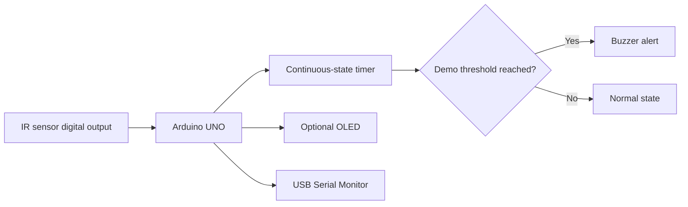

# Driver Drowsiness Alert ECU

An educational embedded prototype that reads a digital IR sensor signal, measures how long a configured sensor state remains active, and demonstrates a buzzer alert with optional OLED status.

## Project overview

The project demonstrates basic embedded input sampling, time-based decision logic and output control using an Arduino-compatible microcontroller.

### Main features

- Read a digital-output IR eye-blink sensor module.
- Track the duration of a continuously detected sensor state.
- Activate a buzzer when the demonstration time threshold is reached.
- Deactivate the buzzer when the sensor returns to its normal state.
- Display status on an optional SSD1306 OLED.
- Print status messages through the serial monitor.

## Hardware used by the starter firmware

| Component | Purpose |
|---|---|
| Arduino UNO | Main controller in the current starter sketch |
| Digital-output IR sensor module | Sensor input |
| Active buzzer module | Alert output |
| SSD1306 I2C OLED (optional) | Status display |
| USB cable | Programming and serial output |
| Breadboard and jumper wires | Prototype connections |

> The current firmware targets Arduino UNO. An ESP32 is mentioned in the initial project description, but its role and any communication link have not yet been confirmed. The starter sketch does not currently use an ESP32.

## System architecture

See [system architecture](docs/system_architecture.md).

## Repository structure

- `firmware/driver_drowsiness_alert.ino` — Arduino starter firmware.
- `docs/system_architecture.md` — block diagram and data flow.
- `docs/pin_connections.md` — proposed pin mapping and sensor polarity notes.
- `docs/libraries.md` — software setup.
- `docs/testing_procedure.md` — bench testing procedure.
- `docs/system_design.md` — initial design notes.
- `docs/testing_and_safety.md` — validation and safety notes.

## Software setup

1. Install Arduino IDE.
2. Select **Arduino UNO** and the correct serial port.
3. Install Adafruit GFX and Adafruit SSD1306 libraries for the optional OLED.
4. Open `firmware/driver_drowsiness_alert.ino`.
5. Verify the IR sensor output polarity and set `EYE_CLOSED_LEVEL` correctly.
6. Compile and upload.
7. Open Serial Monitor at **9600 baud**.

Detailed instructions: [Library and setup guide](docs/libraries.md).

## Demonstration logic

The starter sketch treats a continuous configured sensor state lasting two seconds as an alert condition. This is only a software demonstration threshold; it is not a validated measure of drowsiness or a clinically/automotive established threshold.

## Validation status and limitations

The code is a starter implementation and has not been represented as hardware-tested. Verify sensor polarity, buzzer behavior and optional display operation on a bench. Record actual observations and test evidence before reporting results.

An IR sensor's readings can be affected by placement, ambient light, movement and individual differences. A single digital sensor cannot reliably determine a person's alertness.

## Safety

This is not a certified driver-monitoring or vehicle-safety system. Test electronics on a bench only. Never test while driving or rely on this prototype to decide whether it is safe to drive.

## Author

**Gurubaran G K**  
B.E. Electronics and Communication Engineering
