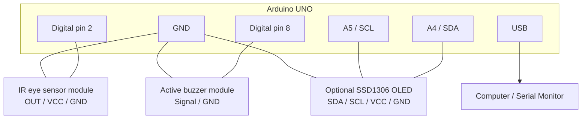

# Proposed Circuit Diagram — Driver Drowsiness Alert ECU

> This is a proposed connection diagram for the Arduino UNO starter sketch. Verify the exact IR sensor output polarity, voltage and buzzer type before wiring.

## Connection overview

## Connection table

| Module pin | Arduino UNO |
|---|---|
| IR sensor OUT | D2 |
| IR sensor VCC | Per module specification |
| IR sensor GND | GND |
| Buzzer signal | D8 |
| Buzzer GND | GND |
| OLED SDA (optional) | A4 |
| OLED SCL (optional) | A5 |
| OLED GND | GND |

## Firmware configuration

The starter sketch assumes a HIGH sensor output means the configured detected state. Verify this on a bench and update `EYE_CLOSED_LEVEL` if your module behaves differently. The current firmware uses a two-second demonstration timer; it is not a validated drowsiness threshold.

## Verification checklist

- [ ] Confirm Arduino UNO is the controller used in the actual build.
- [ ] Confirm sensor output voltage is safe for the UNO input.
- [ ] Confirm sensor active logic level.
- [ ] Confirm buzzer module type and current requirements.
- [ ] Confirm OLED address and voltage if fitted.
- [ ] Test the circuit on a bench only.

## Safety

This prototype is not a certified driver-monitoring system. Never test it while driving or rely on it to decide whether it is safe to drive.
