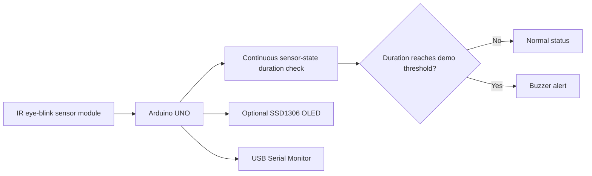

# System Architecture — Driver Drowsiness Alert ECU

## Functional block diagram

## Data flow

1. The IR sensor provides a digital output.
2. Arduino UNO samples the sensor input.
3. Firmware measures how long the configured detected state remains continuously active.
4. If the demonstration threshold is reached, the buzzer output is activated.
5. The optional OLED and serial monitor show status information.

## Current implementation scope

This is a simple educational sensor-state demonstration. It does not reliably determine human alertness, diagnose fatigue, or meet automotive safety standards. Sensor placement, ambient light, eyewear and individual variation can affect readings.

## Design assumptions

- Controller: Arduino UNO
- Sensor: digital-output IR eye-blink sensor
- Buzzer: active buzzer module assumed
- Optional display: SSD1306 I2C OLED
- Sensor input: D2
- Buzzer output: D8
- Demonstration threshold: 2 seconds (must not be interpreted as a validated safety threshold)

Test on a bench only. Never use this prototype while driving or rely on it to decide whether it is safe to drive.
